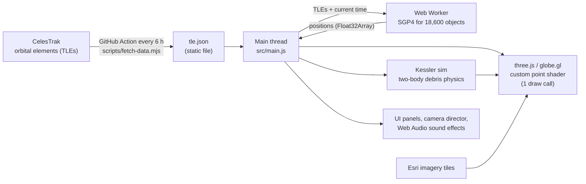

# 🛰️ Skyward

**See every satellite above you, and what happens if they collide.** All ~18,600 tracked objects in Earth orbit, live on a 3D globe, right in your browser.

### ▶️ [Try it live: waazy-w.github.io/skyward](https://waazy-w.github.io/skyward/)


Built solo at **Hack the Skies 2026**.

## What it does

- **Live 3D globe of ~18,600 objects:** every active satellite plus the major debris clouds, predicted second by second.
- **🔭 Above me:** uses your location to show everything above your horizon right now, and the **next time you can see the ISS with your own eyes** (with where to look and for how long).
- **Inspect anything:** click a dot and the camera flies in and follows it. You get height, speed (km/s), lowest/highest point of its orbit, orbit time, its full orbit path, and a **countdown to its next pass over you**.
- **💥 Kessler syndrome simulator:** smash any satellite. The camera swoops in, a fireball and explosion, then it pulls back to follow the debris as it wraps the planet. With chain reactions on, junk starts hitting other satellites, the cascade NASA's Donald Kessler warned about in 1978.
- **Real history:** the red dots are real debris from the 2007 Fengyun-1C missile test, the 2009 Iridium–Cosmos collision and the 2021 Cosmos 1408 test.
- **Filter by type:** show only Starlink, GPS, space stations, other satellites or debris; the view zooms out to fit each orbit shell.
- **Day and night, live:** the night side of Earth is shaded where it really is right now, and satellites inside Earth's shadow are drawn dim. The inspector tells you if an object is in sunlight or in shadow.
- **Shareable links:** every object has its own link (e.g. [`#sat=25544`](https://waazy-w.github.io/skyward/#sat=25544) is the ISS). Search works by name or NORAD catalog number.
- **Time machine:** pause, or fast-forward up to 1 hour per second.
- **Keyboard shortcuts:** <kbd>/</kbd> search, <kbd>Space</kbd> pause, <kbd>1</kbd>–<kbd>3</kbd> switch tabs, <kbd>Esc</kbd> back.
- **HD Earth, sound effects, works on phones.**

## Architecture



Everything runs in the browser. There is no backend: GitHub Pages serves static files, and a scheduled GitHub Action refreshes the orbit data and redeploys.

## How it works

**1. Orbit data.** Every tracked object is published as a *two-line element set* (TLE): six numbers describing its orbit at a moment in time. CelesTrak doesn't allow requests from browsers, so a build script downloads them and ships them as a static JSON file.

**2. Predicting positions (SGP4).** [satellite.js](https://github.com/shashwatak/satellite-js) runs SGP4, the model used by the US Space Force for these elements. It accounts for Earth's bulge, air drag and Sun/Moon pull. It returns position and velocity in an Earth-centred inertial frame (TEME). This runs for all 18,600 objects in a **Web Worker** so the page never freezes.

**3. Coordinate frames.** Each position is rotated into the Earth-fixed frame using Greenwich sidereal time, converted to latitude/longitude/height on the WGS-84 ellipsoid, then to the globe's 3D scene coordinates.

**4. Smooth 60 fps.** The worker updates a few times per second. In between, every dot is extrapolated along its latest motion. The object the camera follows gets an exact SGP4 calculation every frame, so the follow-cam glides.

**5. Rendering.** A custom GLSL shader draws all objects as glowing points in a **single draw call**. Clicking uses ray casting against the points, ignoring any that are hidden behind the Earth.

**5b. Day, night and Earth's shadow.** Every frame the Sun's direction is computed (low-precision solar formula), rotated into the Earth-fixed frame with sidereal time, and passed to the GPU as one uniform. A shader on a thin shell over the globe shades the night side with a soft twilight band. The point shader runs the same cylindrical shadow test as the pass predictor for every object at once, so satellites in Earth's shadow dim on their own.

**6. "Can I see it?"** For your location, the app scans the next 3–4 days in 20-second steps and computes **look angles** (azimuth and elevation). A pass counts as naked-eye visible when the satellite is **in sunlight** (outside Earth's cylindrical shadow, using a solar-position formula) while **your sky is dark** (Sun more than 6° below your horizon).

**7. Orbit facts.** Apogee and perigee come from Kepler's third law, $a = \sqrt[3]{\mu / n^2}$, with $r_{apo/peri} = a(1 \pm e)$, where $n$ is the mean motion and $e$ the eccentricity from the TLE.

**8. Kessler simulator.** A crash spawns hundreds of fragments at the satellite's position and velocity, each with a random kick (random direction, long-tailed speed, mostly 20–300 m/s). Each fragment then follows **two-body gravity**, $\ddot{\vec r} = -\mu \vec r / |\vec r|^3$, integrated with semi-implicit Euler in 5-second steps (stable over many orbits). Fragments that drop below 120 km burn up. For chain reactions, random fragments are checked against the nearest satellite; a close pass can trigger a new break-up.

| Layer | Tech |
|---|---|
| Build & dev | Vite |
| Globe & 3D | globe.gl / three.js, custom GLSL point shader |
| Orbit math | satellite.js (SGP4), own sun position, shadow and pass prediction |
| Physics | own two-body integrator (src/kessler.js) |
| Sound | Web Audio API, all synthesized (no audio files) |
| Hosting | GitHub Pages + scheduled GitHub Actions |

## Run it locally

```bash
npm install
npm run fetch-data   # optional: download the latest orbit data
npm run dev
```

## Project layout

```
src/main.js               app, UI, camera director
src/propagator.worker.js  SGP4 for every object (Web Worker)
src/orbit.js              orbit math: frames, look angles, sun, passes
src/kessler.js            debris physics
src/pointLayer.js         GPU point shader
src/fx.js, src/sound.js   explosion effects and sound
scripts/fetch-data.mjs    downloads orbit data from CelesTrak
```

## Honest notes

- Positions come from public orbital data and are accurate to a few km for most objects. Good for exploring, not for mission planning.
- The Kessler simulation is **sped up and dramatized** so you can watch it happen. Real cascades unfold over years or decades.

Credits: orbit data from [CelesTrak](https://celestrak.org); imagery © Esri, Maxar, Earthstar Geographics.
