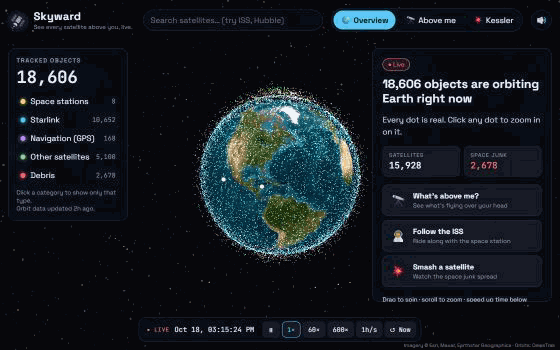
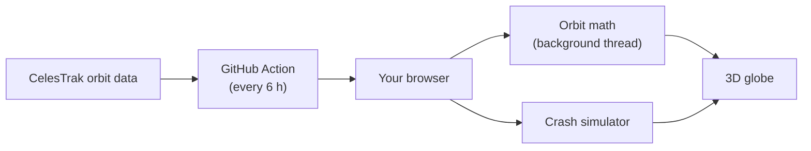

# 🛰️ Skyward

**See every satellite above you, live, and what happens if they crash.**

### ▶️ [Try it: waazy-w.github.io/skyward](https://waazy-w.github.io/skyward/)



Built solo for **Hack the Skies 2026**.

## What you can do

- 🌍 **See all ~18,600 objects in orbit** on a 3D Earth, moving in real time.
- 🔭 **Above me:** see what's over your head right now, and when you can spot the ISS with your own eyes.
- 🛰️ **Click any dot** to fly to it and see its height, speed, orbit and next pass over you.
- 💥 **Smash a satellite** and watch the debris spread around the planet and hit other satellites (the Kessler syndrome).
- 📜 **See real space disasters:** light up what's left of the 2007 Fengyun-1C missile test, the 2009 Iridium–Cosmos crash and the 2021 Cosmos 1408 test.
- ⏩ **Speed up time**, filter by type (Starlink, GPS, debris…) and share a link to any satellite.

## How it works

1. A GitHub Action downloads the latest orbit data from [CelesTrak](https://celestrak.org) every 6 hours.
2. In your browser, [satellite.js](https://github.com/shashwatak/satellite-js) uses the SGP4 orbit model to work out where every object is, in a background thread so the page stays smooth.
3. All the dots are drawn by one custom GPU shader. It also dims satellites that are in Earth's shadow.
4. The crash simulator gives each piece of debris its own orbit using basic gravity physics. Pieces that fall too low burn up.



No server, no sign-up: it's a static site on GitHub Pages.

## Built with

Vite · three.js / globe.gl · satellite.js · Web Audio · GitHub Pages

## Run it yourself

```bash
npm install
npm run dev
```

## Notes

- Positions are accurate to a few km. Great for exploring, not for flying spacecraft.
- The crash simulation is sped up so you can watch it. Real debris cascades take years.

Imagery © Esri, Maxar, Earthstar Geographics · Orbit data: CelesTrak
