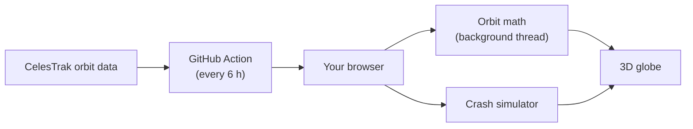

# 🛰️ Skyward

**See every satellite above you, live, and what happens if they crash.**

### ▶️ [Try it: waazy-w.github.io/skyward](https://waazy-w.github.io/skyward/)

Built solo for **Hack the Skies 2026**.

## What you can do

- 🌍 **See all ~18,600 objects in orbit** on a 3D Earth, moving in real time.
- 🔭 **Above me:** see what's over your head right now, and when you can spot the ISS with your own eyes.
- 🛰️ **Click any dot** to fly to it and see its height, speed, orbit, next pass over you, and its closest neighbour in space right now.
- 💥 **Smash a satellite** and watch the debris spread around the planet and hit other satellites (the Kessler syndrome).
- 📜 **See real space disasters:** light up what's left of the 2007 Fengyun-1C missile test, the 2009 Iridium–Cosmos crash and the 2021 Cosmos 1408 test.
- ⏩ **Speed up time**, filter by type (Starlink, GPS, debris…) and share a link to any satellite.

## How it works

1. A GitHub Action downloads the latest orbit data from [CelesTrak](https://celestrak.org) every 6 hours.
2. In your browser, [satellite.js](https://github.com/shashwatak/satellite-js) uses the SGP4 orbit model to work out where every object is, in a background thread so the page stays smooth.
3. All the dots are drawn by one custom GPU shader. It also dims satellites that are in Earth's shadow.
4. The crash simulator gives each piece of debris its own orbit using basic gravity physics. Pieces that fall too low burn up.

No server, no sign-up: it's a static site on GitHub Pages.

<b>Technical deep dive</b> (the math and engineering)

**1. Orbit data.** Every tracked object is published as a *two-line element set* (TLE): six numbers describing its orbit at a moment in time. CelesTrak doesn't allow requests from browsers, so a build script downloads them and ships them as a static JSON file.

**2. Predicting positions (SGP4).** [satellite.js](https://github.com/shashwatak/satellite-js) runs SGP4, the model used by the US Space Force for these elements. It accounts for Earth's bulge, air drag and Sun/Moon pull. It returns position and velocity in an Earth-centred inertial frame (TEME). This runs for all 18,600 objects in a **Web Worker** so the page never freezes.

**3. Coordinate frames.** Each position is rotated into the Earth-fixed frame using Greenwich sidereal time, converted to latitude/longitude/height on the WGS-84 ellipsoid, then to the globe's 3D scene coordinates.

**4. Smooth 60 fps.** The worker updates a few times per second. In between, every dot is extrapolated along its latest motion. The object the camera follows gets an exact SGP4 calculation every frame, so the follow-cam glides.

**5. Rendering.** A custom GLSL shader draws all objects as glowing points in a **single draw call**. Clicking uses ray casting against the points, ignoring any that are hidden behind the Earth.

**6. Day, night and Earth's shadow.** Every frame the Sun's direction is computed (low-precision solar formula), rotated into the Earth-fixed frame with sidereal time, and passed to the GPU as one uniform. A shader on a thin shell over the globe shades the night side with a soft twilight band. The point shader runs the same cylindrical shadow test as the pass predictor for every object at once, so satellites in Earth's shadow dim on their own.

**7. "Can I see it?"** For your location, the app scans the next 3–4 days in 20-second steps and computes **look angles** (azimuth and elevation). A pass counts as naked-eye visible when the satellite is **in sunlight** (outside Earth's cylindrical shadow, using a solar-position formula) while **your sky is dark** (Sun more than 6° below your horizon).

**8. Orbit facts.** Kepler's third law, $a = \sqrt[3]{\mu / n^2}$, gives the orbit's size from its mean motion $n$. Because Earth isn't a perfect sphere, the lowest and highest point shown are measured by running SGP4 across the next full lap, so they always agree with the live height. The closest neighbour is a nearest-point search over all 18,600 live positions.

**9. Kessler simulator.** A crash spawns hundreds of fragments at the satellite's position and velocity, each with a random kick (random direction, long-tailed speed, mostly 20–300 m/s). Each fragment then follows **two-body gravity**, $\ddot{\vec r} = -\mu \vec r / |\vec r|^3$, integrated with semi-implicit Euler in 5-second steps (stable over many orbits). Fragments that drop below 120 km burn up. For chain reactions, random fragments are checked against the nearest satellite; a close pass can trigger a new break-up.

**10. Real debris events.** Debris pieces in the catalogue are named after the object they came from (e.g. `FENGYUN 1C DEB`), so the app can light up exactly what's left of each historic break-up.

## Built with

Vite · three.js / globe.gl · satellite.js · Web Audio · GitHub Pages

## Notes

- Positions are accurate to a few km. Great for exploring, not for flying spacecraft.
- The crash simulation is sped up so you can watch it. Real debris cascades take years.

Imagery © Esri, Maxar, Earthstar Geographics · Orbit data: CelesTrak
